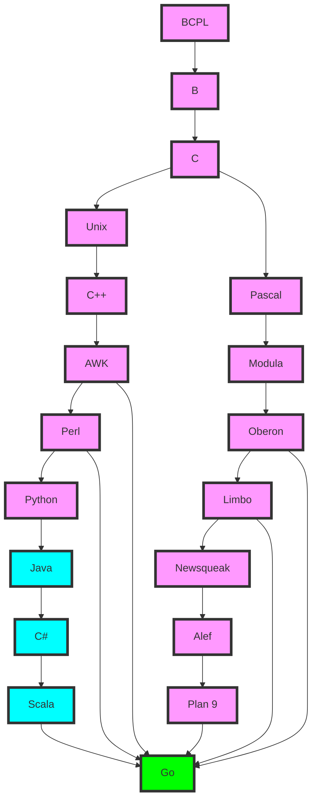

### The genealogy chart of the Go language

This chart shows where Go came from and the languages it influenced.

You can read this chart in four blocks: origin, evolution, birth, and influence.

- **Origin**:
  - BCPL, B, and C are Go's ancestor languages, representing the early evolution of programming languages.
  - Systems and languages such as Unix and Pascal had an important influence on the development of C and C++.

- **Evolution**:
  - Languages such as C++, AWK, and Modula grew out of C.
  - Scripting languages such as Perl and Python simplified programming and improved development efficiency.
  - Java and C# introduced object-oriented programming and garbage collection.
  - Squeak and Newsqueak provided the basis for concurrent programming.

- **The birth of Go**:
  - Go absorbed the lessons of these languages — C-family syntax, the ease of scripting languages, the concurrency model, garbage collection — and made them into a language with concise syntax and built-in concurrency support.

- **Influence**:
  - Go is widely used in cloud computing, containerization, and microservices: projects such as Docker, Kubernetes, gRPC, etcd, and Prometheus are all written in Go.

## References

- [Official documentation overview](https://go.dev/doc/)
- [Release history and support policy](https://go.dev/doc/devel/release)
- [Official FAQ](https://go.dev/doc/faq)

## Sibling pages

- [ReleaseNotes](/introduction/ReleaseNotes.md)
- [Feature](/introduction/Feature.md)
- [Introduction](/introduction/Introduction.md)

<!-- BACKLINKS-AUTO -->
## Related pages

- [Feature](/introduction/Feature.md)
- [Introduction](/introduction/Introduction.md)
